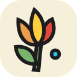
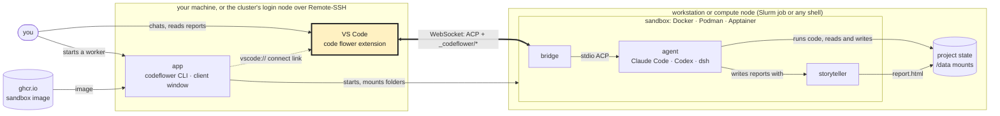

<p align="center">
  
</p>

<h1 align="center">code flower for VS Code</h1>

<p align="center">Chat with the agents in your code flower sandboxes, right in VS Code.</p>

<p align="center">
  <a href="https://github.com/lutrarutra/codeflower-launcher"> launcher</a>
  &nbsp;·&nbsp;
  <a href="https://github.com/lutrarutra/codeflower-sandbox"> sandbox</a>
  &nbsp;·&nbsp;
  <b> VS Code extension</b>
  &nbsp;·&nbsp;
  <a href="https://github.com/lutrarutra/storyteller"> storyteller</a>
  &nbsp;·&nbsp;
  <a href="https://codeflower.dev">codeflower.dev</a>
</p>

The VS Code extension of code flower: it connects to code flower workers (sandboxes started by
[codeflower-launcher](https://github.com/lutrarutra/codeflower-launcher)), lists them with their
sessions, and opens a chat (a Svelte webview in `webview/`) per session.

## How code flower fits together

The highlighted part is this repository, the VS Code extension.



1. Start a worker with the app (`codeflower interactive`, or the client window), on a workstation or
   as a cluster job. It downloads the sandbox image once and starts it with your folders mounted.
2. The worker prints a `codeflower://` address. Paste it into the VS Code extension, or click the worker's
   link in the client window.
3. Chat with the agent in VS Code. The extension talks to the sandbox's bridge over one WebSocket; the
   bridge runs the agent, which sees only the mounted folders.
4. The agent writes its findings as storyteller reports, which open in VS Code beside the chat.

## Install

Download `codeflower-<version>.vsix` from the
[releases](https://github.com/lutrarutra/codeflower-vsc-extension/releases) and install it with
*Extensions → ⋯ → Install from VSIX…*, or `code --install-extension codeflower-<version>.vsix`.

## Development

```sh
npm ci && npm --prefix webview ci
npm run check   # TypeScript
npm test        # unit tests
npm run build   # webview + dist/extension.cjs
```

F5 in this folder runs the extension alone. To develop it against a real worker (F5 "Extension + dev
worker", the run-codeflower driver, the integration tests), clone
[codeflower-workspace](https://github.com/lutrarutra/codeflower-workspace), which has this repo as
the `extension/` submodule. The protocol the extension speaks with the bridge is described in its
[architecture document](https://github.com/lutrarutra/codeflower-workspace/blob/main/docs/architecture.md).
